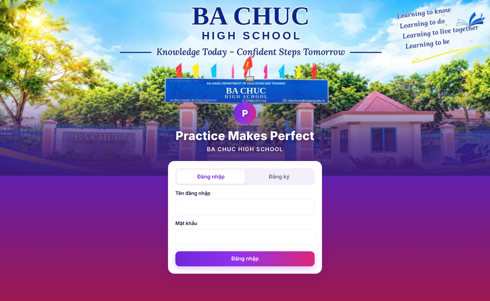
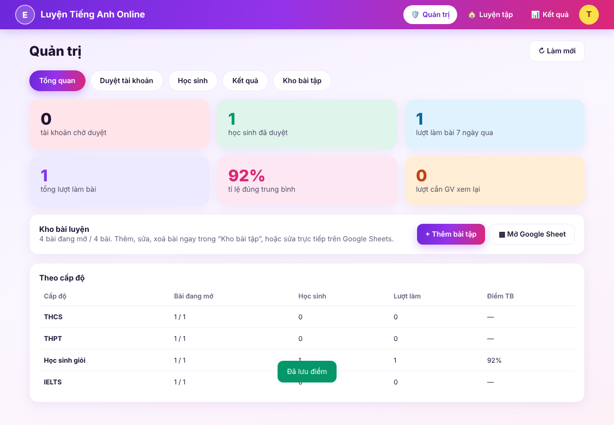
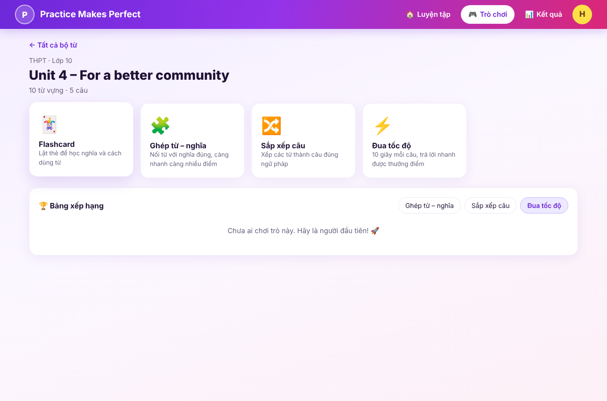

# Practice Makes Perfect

Web app luyện Tiếng Anh online cho học sinh **Ba Chuc High School**, chạy miễn phí bằng **Google Sheet + Google Apps Script**.

## Tính năng

**Học sinh**
- Đăng ký (chọn lớp), chờ giáo viên duyệt rồi đăng nhập
- Luyện bài theo cấp độ: THCS (Lớp 6–9), THPT (Lớp 10–12), Học sinh giỏi, IELTS (theo band)
- 4 dạng câu: trắc nghiệm A–D, điền từ / viết lại câu, đọc hiểu / nghe, tự luận
- Xem điểm, đáp án và giải thích ngay sau khi nộp
- Mục **Bài được giao** có hạn nộp
- 4 trò chơi ôn tập: Flashcard, Ghép từ – nghĩa, Sắp xếp câu, Đua tốc độ, có bảng xếp hạng
- **Luyện đề** khối 10 – 11 – 12 (giữa kì, cuối kì, luyện thi tốt nghiệp): làm cả đề có đồng hồ đếm ngược, phần nghe do máy tự đọc, chấm thang 10 kèm điểm từng phần

**Giáo viên** (trang Quản trị)
- Tổng quan, duyệt tài khoản, quản lý học sinh (khoá, xếp lớp, cấp quyền GV, đặt lại mật khẩu)
- Kết quả và chấm bài tự luận
- Giao bài theo lớp, theo dõi ai đã làm, chưa làm, nộp muộn
- Kho bài tập: soạn bài, dán nhanh nhiều câu một lần
- Bộ từ cho trò chơi, nhập nhiều bộ cùng lúc
- Đề thi: nhập cả đề bằng một file, công tắc xem đáp án (ngay / khi GV mở), thống kê điểm từng phần theo lớp

| Quản trị | Trò chơi | Học sinh |
|---|---|---|
|  |  |  |

## Cấu trúc

| File | Vai trò |
|---|---|
| `Code.gs` | Phần máy chủ (Apps Script): tài khoản, chấm điểm, lưu dữ liệu vào Google Sheet |
| `Index.html` | Giao diện (HTML + CSS + JavaScript) |
| `Banner.html` | Hình nền trường, mã hoá dạng data URI |
| `data/bo-tu-lop-10.md`, `bo-tu-lop-11.md`, `bo-tu-lop-12.md` | 30 bộ từ lớp 10 – 11 – 12 cho chức năng "Nhập nhiều bộ" |
| `data/de-thi/` | Đề thi để nhập vào mục Luyện đề (Quản trị → Đề thi → + Thêm đề) |

Dữ liệu nằm trong Google Sheet, gồm các trang tính Users, Exercises, Questions, Results, WordSets, Words, GameScores, Classes, Assignments, Exams, ExamParts, ExamResults. Các trang tính này được tạo tự động khi chạy `setup`.

## Cài đặt

1. Tạo một Google Sheet mới → **Tiện ích mở rộng → Apps Script**.
2. Dán nội dung `Code.gs` vào file Code.gs. Ở đầu file, **đổi `ADMIN_PASSWORD`**.
3. Thêm 2 file HTML tên **Index** và **Banner**, dán nội dung tương ứng.
4. Chọn hàm `setup`, bấm **▶ Chạy** và cấp quyền.
5. **Triển khai → Tùy chọn triển khai mới → Ứng dụng web**. Ở mục Thực thi với tư cách, chọn **Tôi**. Ở mục Người có quyền truy cập, chọn **Bất kỳ ai**.
6. Mở link `/exec` và đăng nhập bằng `admin`.

Sau mỗi lần sửa code: **Triển khai → Quản lý các bản triển khai → ✏️ → Phiên bản mới**. Link giữ nguyên.

Quên mật khẩu admin: sửa `ADMIN_PASSWORD` rồi chạy hàm `resetAdminPassword`.

## Lưu ý bảo mật

Mật khẩu trong `Code.gs` ở kho này chỉ là mật khẩu mẫu. **Đừng commit mật khẩu thật** lên GitHub. Mật khẩu thật chỉ đặt trong Apps Script của bạn.
